<!-- ALL-CONTRIBUTORS-BADGE:START - Do not remove or modify this section -->
[](#contributors)
<!-- ALL-CONTRIBUTORS-BADGE:END -->
[](https://github.com/nao1215/sns-terminal-clients/actions/workflows/rust.yml)
[](https://github.com/nao1215/sns-terminal-clients/actions/workflows/e2e.yml)

[](https://github.com/nao1215/sns-terminal-clients/actions/workflows/gitleaks.yml)
[](https://github.com/nao1215/sns-terminal-clients/actions/workflows/trivy.yml)
[](https://github.com/nao1215/sns-terminal-clients/actions/workflows/cargo-deny.yml)
[](https://github.com/nao1215/atago)
[](https://github.com/nao1215/himorime)
[](https://crates.io/crates/bluesky-terminal-client)
[](https://crates.io/crates/bluesky-terminal-client)
[](https://github.com/nao1215/sns-terminal-clients/releases)
[](./LICENSE)
[](https://scorecard.dev/viewer/?uri=github.com/nao1215/sns-terminal-clients)

# bsky

A [Bluesky](https://bsky.app) client for the terminal. Pictures and videos are drawn in place.


## Install

```sh
brew install nao1215/tap/bsky
cargo install --locked bluesky-terminal-client
cargo binstall bluesky-terminal-client
```

Binaries for Linux, macOS and Windows are on the [releases page](https://github.com/nao1215/sns-terminal-clients/releases), with the license texts of the crates they contain in `bsky-<version>-THIRD_PARTY_LICENSES.html`.

### Verifying a release

Each release from 0.13.0 on carries `checksums.txt`, a cosign signature of it, and SLSA provenance, and each archive has a GitHub build attestation. In a directory with the downloaded files (`<tag>` is the release, for example `v0.13.0`):

```sh
sha256sum --ignore-missing --check checksums.txt
cosign verify-blob --bundle checksums.txt.sigstore.json \
  --certificate-identity "https://github.com/nao1215/sns-terminal-clients/.github/workflows/release.yml@refs/tags/<tag>" \
  --certificate-oidc-issuer https://token.actions.githubusercontent.com \
  checksums.txt
slsa-verifier verify-artifact <archive> --provenance-path bsky-<tag>.intoto.jsonl \
  --source-uri github.com/nao1215/sns-terminal-clients --source-tag <tag>
gh attestation verify <archive> --repo nao1215/sns-terminal-clients
```

## Use

Run `bsky` and log in. An [app password](https://bsky.app/settings/app-passwords) is safer than your password. `?` lists every key, `.` what the keys do to the selected post.

| Pictures with | Terminals |
|---|---|
| kitty graphics | kitty, Ghostty |
| sixel | foot, mlterm, Windows Terminal 1.22+ |
| iTerm2 images | iTerm2, WezTerm |

Other terminals get text, and `Space` opens a post in the browser. Photos and videos are posted without their location data.

A post without pictures, video or a quote gets a card for its first link, built from the page's title, description and picture as Bluesky's app does. bsky fetches the page from your computer and skips a picture hosted on your own network. The Link cards setting, `bsky post --no-card` and `BSKY_LINK_CARDS=off` turn cards off.

bsky speaks English, 日本語, 简体中文, 한국어, Русский, Español, Français, Deutsch and Português: the language of your system, or the one chosen in the settings (`s` on your profile).

## Screens

| `Space`: pictures and videos | `n` `Ctrl+O`: attach pictures or a video |
|:--:|:--:|
| 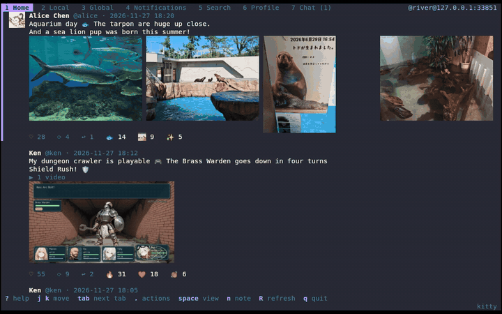 | 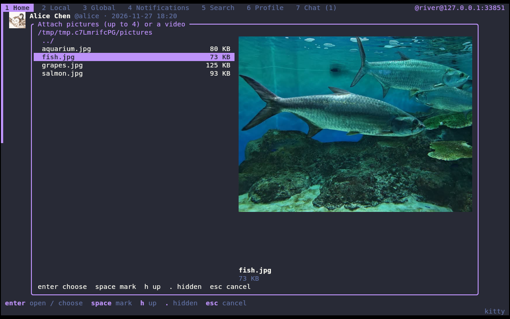 |
| `v`: thread | `/`: search |
|  | 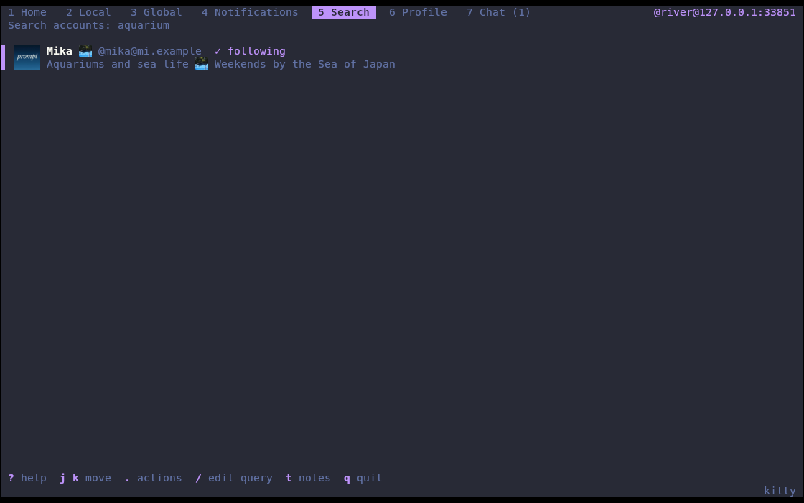 |
| `.`: actions | `e`: edit your profile |
| 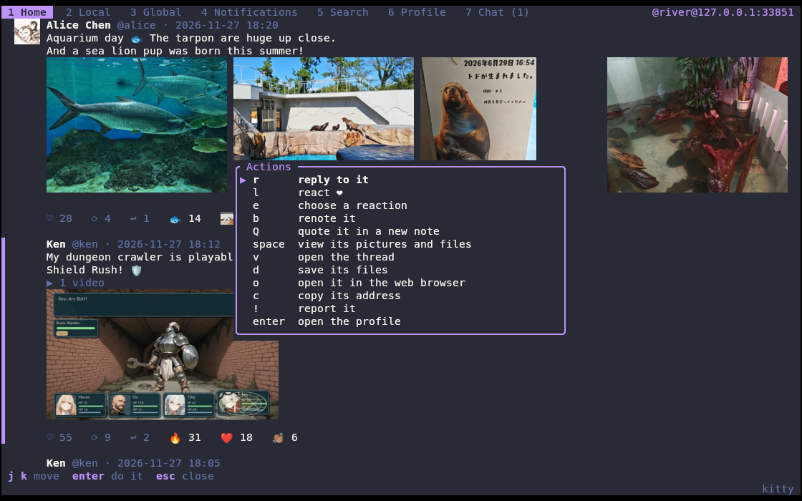 | 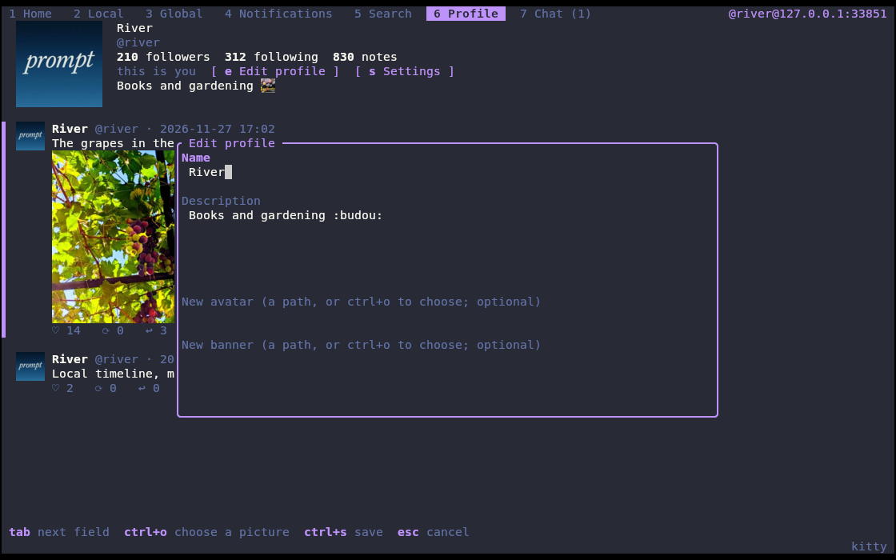 |
| `2`: chat | `A`: accounts |
|  | 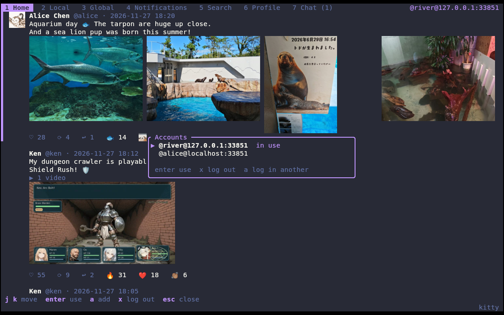 |
| `s`: settings | text only |
| 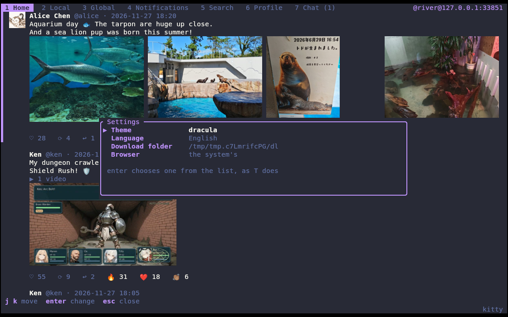 | 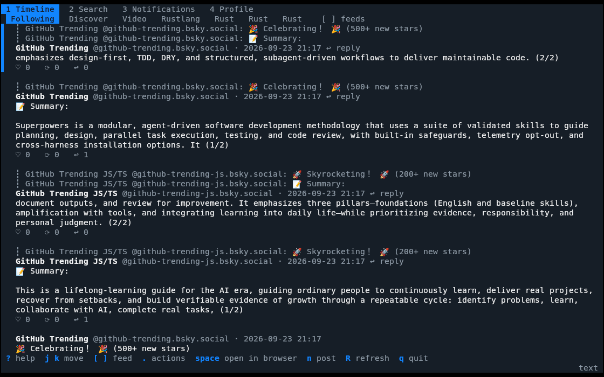 |

`+` on the timeline: your pinned feeds, notifications or a search in columns beside it


`T`: 42 themes

| | | |
|:--:|:--:|:--:|
| 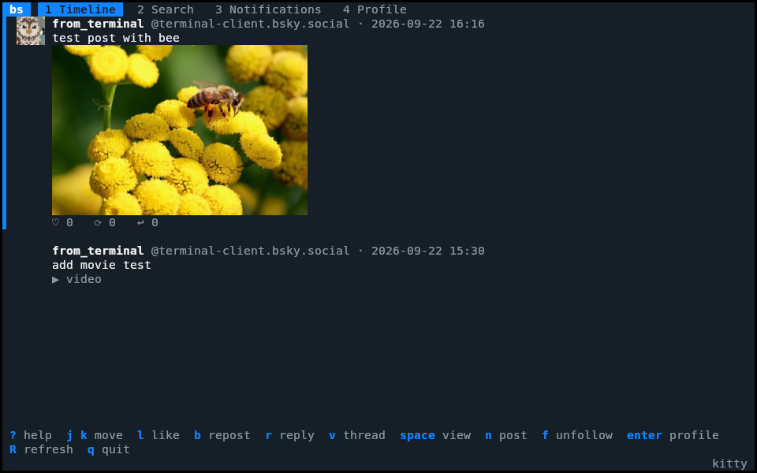 | 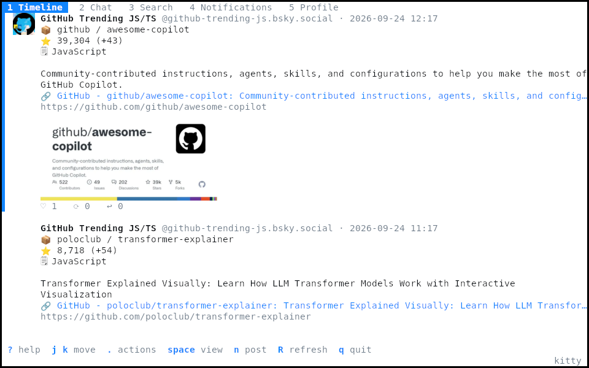 | 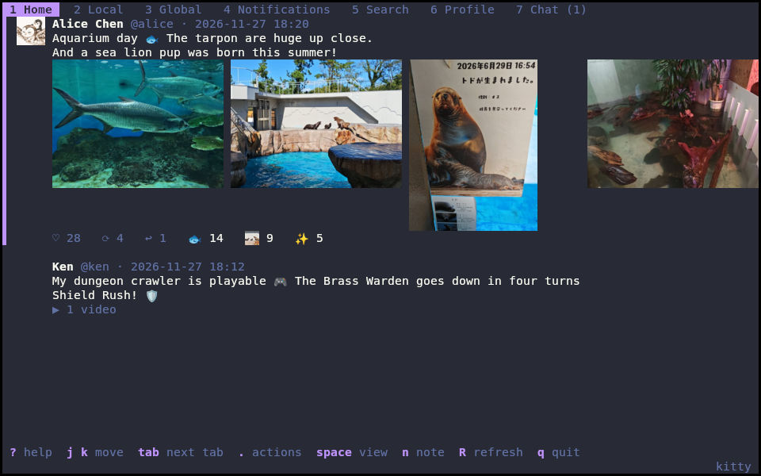 |
| 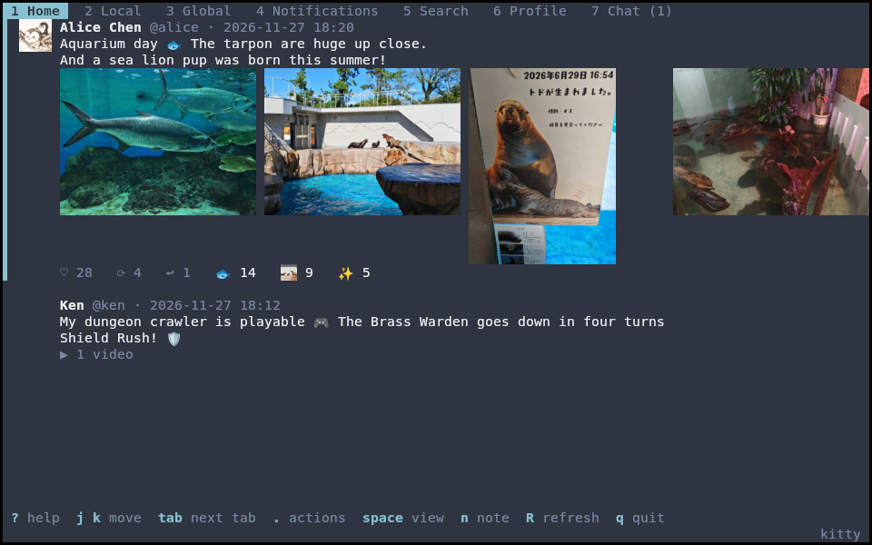 |  | 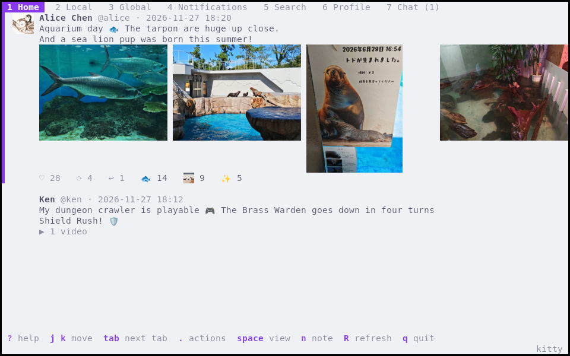 |

Chat, accounts and columns show made-up data served by [doc/demo-server.py](doc/demo-server.py); the composer browses the pictures in [doc/demo](doc/demo).

## Keys

| Key | Action |
|---|---|
| `1` to `5` | Timeline, Chat, Search, Notifications, Profile |
| `+` `x` | Add a column (a pinned feed, notifications, a search), remove one |
| `j` `k` | Move |
| `n` `r` `Q` | Post, reply, quote |
| `l` `b` `f` | Like, repost, follow |
| `M` `B` | Mute, block |
| `D` | Delete your post |
| `v` `Space` `o` | Thread, pictures or video, link |
| `/` | Search |
| `m` | Message the profile shown |
| `A` `T` `s` | Accounts, themes, settings |
| `?` `q` | Help, quit |

## Commands

```sh
bsky tl -n 5
bsky post "hello" --image cat.jpg
bsky search rust --json | jq -r .uri
bsky author alice.bsky.social -n 100 --filter no-replies
bsky download https://bsky.app/profile/alice.bsky.social/post/3l... -o pics
```

`bsky author` reads an account's own feed page by page, so it leaves out nothing a search for `from:` can miss. `bsky download` saves a post's pictures and video where `d` in the viewer does, and `bsky author ... --download` saves those of every post it read. `bsky --help` lists them all.

## Environment

| Variable | Meaning |
|---|---|
| `BSKY_ACCOUNT` | Account for this run (also `-a`) |
| `BSKY_CONFIG_DIR` | Config folder |
| `BSKY_CACHE_DIR` | Picture cache; `off` for none |
| `BSKY_DOWNLOAD_DIR` | Where `d` saves |
| `BSKY_GRAPHICS` | `kitty`, `sixel` or `iterm2` |
| `BSKY_BROWSER` | Program that opens links |
| `BSKY_SERVICE` | PDS to log in to (also `--service`) |
| `BSKY_VIDEO_SERVICE` | Video upload service |
| `BSKY_LINK_CARDS` | `off` for posts without a link card |
| `LANG` | Language, unless one is chosen in the settings |
| `NO_COLOR` | No color |

## Other terminal clients

From their READMEs and source, September 2026.

| | bsky | [tuisky](https://github.com/sugyan/tuisky) | [mattn/bsky](https://github.com/mattn/bsky) |
|---|---|---|---|
| Written in | Rust | Rust | Go |
| Interface | Full screen, and commands | Full screen | Commands |
| Pictures and videos | Drawn in the terminal | Links to the browser | Not shown |
| Several columns | Yes | Yes | Not applicable |
| Several accounts | Yes | Yes | Yes |
| Refreshes by itself | Chat only | Yes | `stream` |
| Notifications | Yes | No | Yes |
| Direct messages | Yes | No | Yes |
| Posting | Text, pictures, video, reply, quote | Text, pictures, quote | Text, pictures, video, reply, quote |
| Mute and block | Yes | No | Yes |
| Lists, report, app passwords | Yes | No | Yes |
| Invite codes | No | No | Yes |
| JSON output | Every command | No | Most commands |
| Key bindings | Fixed | Set in TOML | Not applicable |
| MCP server | No | No | Yes |

## Related projects

- [msky](https://github.com/nao1215/misskey-terminal-client): the same client for Misskey, with the same keys.

## Testing

| Technique | Bug class caught here |
|---|---|
| [Unit tests](doc/testing.md#unit-tests) | Wrong answers for the cases someone wrote down |
| [State-transition tests](doc/testing.md#state-transition-tests) | Panics, selections outside their list and doubled writes after random keys and late answers |
| [End-to-end tests](doc/testing.md#end-to-end-tests) | Wrong screens, pictures, requests and files from the real binary on Linux, macOS and Windows |
| [Property-based tests](doc/testing.md#property-based-tests) | Split emoji, lines wider than the column and facet ranges off by a byte, for text nobody listed |
| [Metamorphic tests](doc/testing.md#metamorphic-tests) | Layout and facets that change when unrelated text is put beside them |
| [Mutation tests](doc/testing.md#mutation-tests) | Lines the tests run but whose answer no test checks |
| [Fuzzing](doc/testing.md#fuzzing) | Panics and wrong answers on malformed video streams, playlists, posts and web pages |
| [Benchmarks](doc/testing.md#benchmarks) | Slower start-up and commands slipping in unnoticed |

[Where each technique runs and how to run it](doc/testing.md).

## Contributing

```sh
just test    # unit tests
just e2e     # end-to-end tests (atago)
just bench   # performance (himorime)
```

See [CONTRIBUTING.md](CONTRIBUTING.md).

## Contributors

Everyone who reports a bug, suggests a feature, sends a pull request, or packages bsky is listed here ([emoji key](https://allcontributors.org/docs/en/emoji-key)).

<!-- ALL-CONTRIBUTORS-LIST:START - Do not remove or modify this section -->
<!-- prettier-ignore-start -->
<!-- markdownlint-disable -->
<table>
  <tbody>
    <tr>
      <td align="center" valign="top" width="14.28%"><a href="https://debimate.jp/"><br /><sub><b>CHIKAMATSU Naohiro</b></sub></a><br /><a href="https://github.com/nao1215/sns-terminal-clients/commits?author=nao1215" title="Code">💻</a> <a href="https://github.com/nao1215/sns-terminal-clients/commits?author=nao1215" title="Documentation">📖</a></td>
    </tr>
  </tbody>
</table>

<!-- markdownlint-restore -->
<!-- prettier-ignore-end -->

<!-- ALL-CONTRIBUTORS-LIST:END -->

## License

[MIT](LICENSE). Not made by or affiliated with Bluesky Social PBC.
