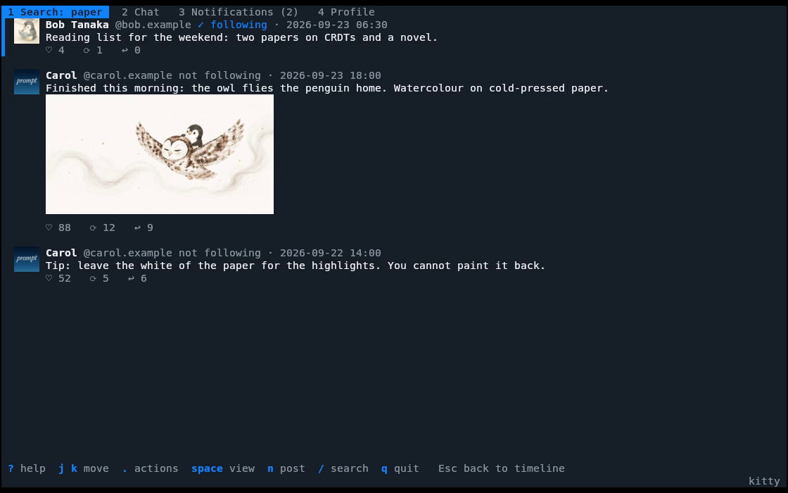
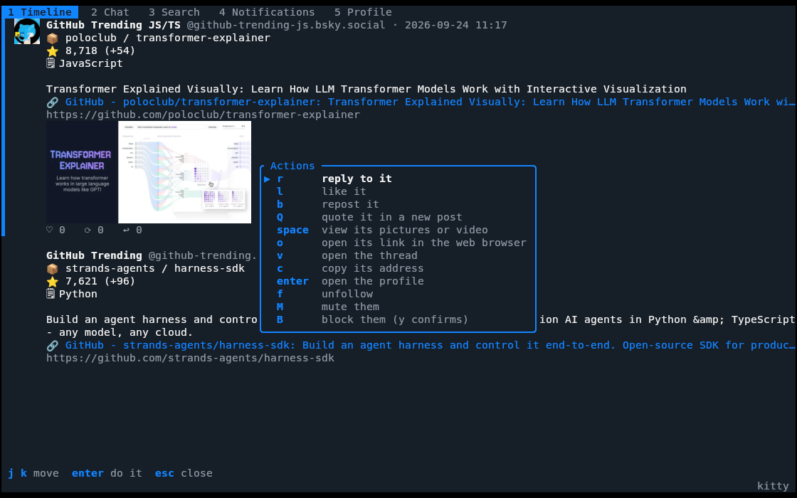
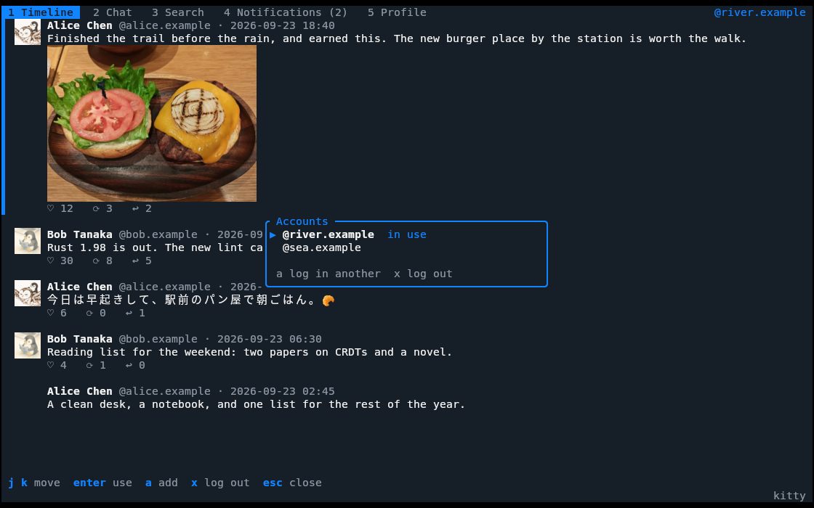
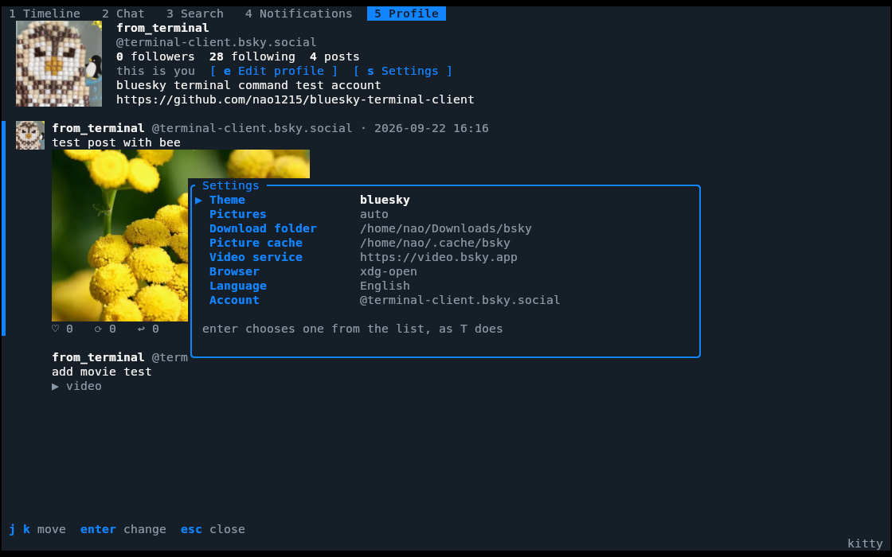
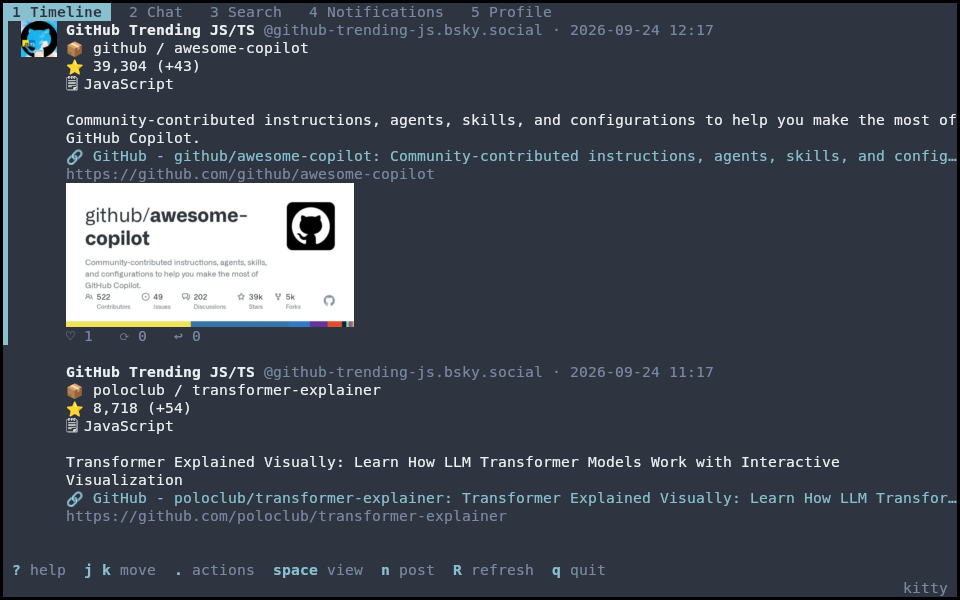
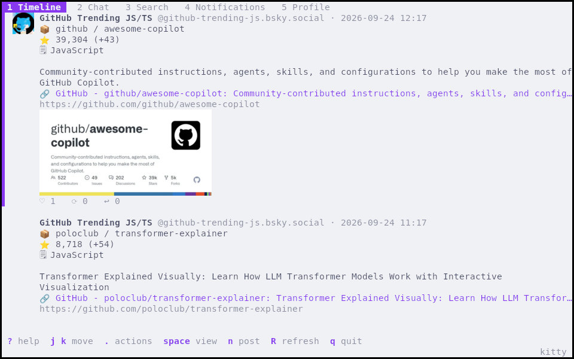
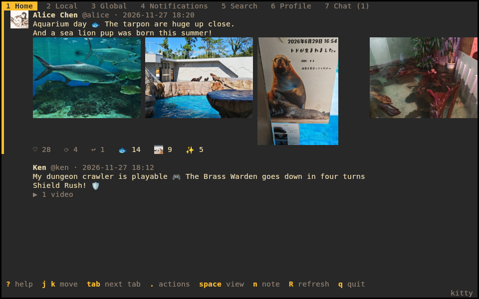

<!-- ALL-CONTRIBUTORS-BADGE:START - Do not remove or modify this section -->
[](#contributors)
<!-- ALL-CONTRIBUTORS-BADGE:END -->
[](https://github.com/nao1215/social-terminal-clients/actions/workflows/rust.yml)
[](https://github.com/nao1215/social-terminal-clients/actions/workflows/e2e.yml)

[](https://github.com/nao1215/social-terminal-clients/actions/workflows/gitleaks.yml)
[](https://github.com/nao1215/social-terminal-clients/actions/workflows/trivy.yml)
[](https://github.com/nao1215/social-terminal-clients/actions/workflows/cargo-deny.yml)
[](https://github.com/nao1215/atago)
[](https://github.com/nao1215/himorime)
[](./LICENSE)
[](https://scorecard.dev/viewer/?uri=github.com/nao1215/social-terminal-clients)


# social-terminal-clients

Unofficial [Bluesky](https://bsky.app) and [Misskey](https://misskey-hub.net) clients for the terminal: `bsky` and `msky`. Pictures and videos are drawn in place.

<table>
  <tr>
    <th width="50%">bsky (Bluesky)</th>
    <th width="50%">msky (Misskey)</th>
  </tr>
  <tr>
    <td></td>
    <td></td>
  </tr>
</table>

| Client | Crate | Version | Downloads |
|---|---|---|---|
| bsky | `bluesky-terminal-client` | [](https://crates.io/crates/bluesky-terminal-client) |  |
| msky | `misskey-terminal-client` | [](https://crates.io/crates/misskey-terminal-client) |  |

## Install

```sh
brew install nao1215/tap/bsky nao1215/tap/msky
cargo install --locked bluesky-terminal-client misskey-terminal-client
cargo binstall bluesky-terminal-client misskey-terminal-client
```

Binaries for Linux, macOS and Windows are on releases pages: bsky's on [this repository's](https://github.com/nao1215/social-terminal-clients/releases), tagged `v<version>`, and msky's (0.1.1 and earlier) on [nao1215/misskey-terminal-client's](https://github.com/nao1215/misskey-terminal-client/releases), tagged `v<version>`. Each release carries the license texts of the crates its binaries contain in `<client>-<version>-THIRD_PARTY_LICENSES.html`. Building needs Rust 1.90 or later.

### Verifying a release

A release carries `checksums.txt`, a cosign signature of it and SLSA provenance, and each archive has a GitHub build attestation (bsky from 0.13.0 on). In a directory with the downloaded files:

```sh
sha256sum --ignore-missing --check checksums.txt
cosign verify-blob --bundle checksums.txt.sigstore.json \
  --certificate-identity "https://github.com/<repo>/.github/workflows/release.yml@refs/tags/<tag>" \
  --certificate-oidc-issuer https://token.actions.githubusercontent.com \
  checksums.txt
slsa-verifier verify-artifact <archive> --provenance-path <client>-<tag>.intoto.jsonl \
  --source-uri github.com/<repo> --source-tag <tag>
gh attestation verify <archive> --repo <repo>
```

`<repo>` is `nao1215/social-terminal-clients` for bsky and `nao1215/misskey-terminal-client` for msky, `<client>` is `bsky` or `msky`, and `<tag>` is the release, for example `v0.15.0`.

## Use

Run `bsky` or `msky` and log in.

- bsky: your handle and an [app password](https://bsky.app/settings/app-passwords), which is safer than your password.
- msky: pick a server and allow msky in the browser that opens. MiAuth logs you in, so msky never sees your password; `esc` reads the server as a visitor.

| Pictures with | Terminals |
|---|---|
| kitty graphics | kitty, Ghostty |
| sixel | foot, mlterm, Windows Terminal 1.22+ |
| iTerm2 images | iTerm2, WezTerm |

Other terminals get text, and `space` opens a post in the browser. `?` lists every key, `.` what the keys do to the selected post. Both clients have 42 themes (`T`), columns beside the timeline (`+`), several accounts (`A`), notifications and direct messages, and every command prints JSON with `--json`. Photos and videos are posted without their location data.

What only one of them does:

- bsky gives a post without pictures, video or a quote a card for its first link, built from the page's title, description and picture as Bluesky's app does. It fetches the page from your computer and skips a picture hosted on your own network; the Link cards setting, `bsky post --no-card` and `BSKY_LINK_CARDS=off` turn cards off.
- bsky speaks English, 日本語, 简体中文, 한국어, Русский, Español, Français, Deutsch and Português; msky English and 日本語. Each follows your system, or the language chosen in the settings (`s`).
- msky draws custom emoji as pictures, shows MFM as plain text with bold kept, and opens a content warning with `w`. It plays MP4 videos with H.264 without sound; `d` saves other formats and `o` opens them.
- msky is written for Misskey itself; forks such as Sharkey may work, but they are not tested. It hides the Chat tab on servers without chat, such as misskey.io.

## Screens

| bsky `space`: pictures and videos | msky `n` `ctrl+o`: attach pictures or a video |
|:--:|:--:|
|  |  |
| msky `v`: thread | bsky `/`: search |
|  |  |
| bsky `.`: actions | msky `e`: edit your profile |
|  |  |
| msky `7`: chat | bsky `A`: accounts |
|  |  |
| bsky `s`: settings | bsky without pictures |
|  |  |

msky `+`: an antenna, then the notifications, beside the home timeline


`T`: 42 themes

| | | |
|:--:|:--:|:--:|
|  |  |  |
|  |  |  |

msky's screens and bsky's chat and accounts show made-up data served by each client's `doc/demo-server.py`; the composers browse the author's photos in `doc/demo`.

## Keys

| Key | bsky | msky |
|---|---|---|
| `1` … | `1`–`5`: Timeline, Chat, Search, Notifications, Profile | `1`–`7`: Home, Local, Global, Notifications, Search, Profile, Chat |
| `+` `x` | Add a column, remove one | Add a column, remove one |
| `j` `k` | Move | Move |
| `n` `r` `Q` | Post, reply, quote | Note, reply, quote |
| `l` | Like | React ❤ |
| `e` | Edit your profile (on it) | Choose a reaction; edit your profile (on it) |
| `b` `f` | Repost, follow | Renote, follow |
| `M` `B` `D` | Mute, block, delete your post | Mute, block, delete your note |
| `!` | | Report |
| `v` `space` | Thread, pictures or video | Thread, pictures or video |
| `w` | | Content warning |
| `d` `o` `c` | `d` in the viewer: save; `o`: link | Save files, open in the browser, copy the address |
| `/` `m` | Search, message the profile shown | Search, message the profile shown |
| `A` `T` `s` | Accounts, themes, settings | Accounts, themes, settings |
| `?` `q` | Help, quit | Help, quit |

## Commands

```sh
bsky tl -n 5
bsky post "hello" --image cat.jpg
bsky search rust --json | jq -r .uri
bsky author alice.bsky.social -n 100 --filter no-replies
bsky download https://bsky.app/profile/alice.bsky.social/post/3l... -o pics

msky timeline -n 5
msky post "hello" --image cat.jpg
msky search Misskey --json | jq -r .url
```

`bsky author` reads an account's own feed page by page, so it leaves out nothing a search for `from:` can miss. `bsky download` saves a post's pictures and video where `d` in the viewer does, and `bsky author ... --download` saves those of every post it read. `msky` takes an access token in `MSKY_TOKEN` for posting from CI. `--help` lists every command.

## Environment

| Meaning | bsky | msky |
|---|---|---|
| Account or server for this run | `BSKY_ACCOUNT` (also `-a`) | `MSKY_HOST` (also `--host`) |
| Access token in place of the saved login | | `MSKY_TOKEN`, on `MSKY_HOST` only |
| Config folder | `BSKY_CONFIG_DIR` | `MSKY_CONFIG_DIR` |
| Picture cache; `off` for none | `BSKY_CACHE_DIR` | `MSKY_CACHE_DIR` |
| Where files are saved | `BSKY_DOWNLOAD_DIR` | `MSKY_DOWNLOAD_DIR` |
| `kitty`, `sixel` or `iterm2` | `BSKY_GRAPHICS` | `MSKY_GRAPHICS` |
| Program that opens links | `BSKY_BROWSER` | `MSKY_BROWSER` |
| PDS to log in to (also `--service`) | `BSKY_SERVICE` | |
| Video upload service | `BSKY_VIDEO_SERVICE` | |
| `off` for posts without a link card | `BSKY_LINK_CARDS` | |

`LANG` picks the language unless one is chosen in the settings, and `NO_COLOR` turns color off.

## Other terminal clients

From their READMEs and source, September 2026.

| | bsky | [tuisky](https://github.com/sugyan/tuisky) | [mattn/bsky](https://github.com/mattn/bsky) |
|---|---|---|---|
| Written in | Rust | Rust | Go |
| Interface | Full screen, and commands | Full screen | Commands |
| Pictures and videos | Drawn in the terminal | Links to the browser | Not shown |
| Several columns | Yes | Yes | Not applicable |
| Several accounts | Yes | Yes | Yes |
| Refreshes by itself | Chat only | Yes | `stream` |
| Notifications | Yes | No | Yes |
| Direct messages | Yes | No | Yes |
| Posting | Text, pictures, video, reply, quote | Text, pictures, quote | Text, pictures, video, reply, quote |
| Mute and block | Yes | No | Yes |
| Lists, report, app passwords | Yes | No | Yes |
| Invite codes | No | No | Yes |
| JSON output | Every command | No | Most commands |
| Key bindings | Fixed | Set in TOML | Not applicable |
| MCP server | No | No | Yes |

From their READMEs, November 2026.

| | msky | [misskey-cli](https://github.com/mikuta0407/misskey-cli) | [Misskey-TUI](https://github.com/yulog/misskey-tui) |
|---|---|---|---|
| Written in | Rust | Go | Go |
| Interface | Full screen, and commands | Commands | Full screen |
| Pictures and videos | Drawn in the terminal | Marked as attached | Not shown |
| Timelines | Home, local, global, social (commands) | Home, local, global, streaming | Home, local, social, global |
| Several columns | Yes | Not applicable | No |
| Several servers | Yes | Yes | No |
| Notifications | Yes | No | No |
| Chat | Yes | No | No |
| Posting | Text, pictures, video, reply, quote, content warning | Text, reply, renote, delete | Text, reply, renote |
| Follow, mute and block | Yes | No | No |
| Search | Notes and accounts | No | No |
| JSON output | Every command | No | Not applicable |
| Login | MiAuth in the browser | Access token in a TOML file | Access token in a JSON file |

## Testing

Both clients are tested the same ways:

| Technique | Bug class caught here |
|---|---|
| Unit tests | Wrong answers for the cases someone wrote down |
| Property-based tests | Split emoji, lines wider than the column, and text nobody listed |
| End-to-end tests ([atago](https://github.com/nao1215/atago)) | Wrong screens, pictures, requests and files from the real binary on Linux, macOS and Windows |
| Fuzzing | Panics and wrong answers on malformed videos, posts and web pages |
| Mutation tests | Lines the tests run but whose answer no test checks |
| Benchmarks ([himorime](https://github.com/nao1215/himorime)) | Slower start-up and commands slipping in unnoticed |

## Contributing

Each client is a crate in `crates/`, and `crates/terminal-kit` holds the terminal drawing code they share.

```sh
just test    # unit tests of every crate
just e2e     # end-to-end tests of both clients (atago)
```

See [CONTRIBUTING.md](CONTRIBUTING.md).

## Contributors

Everyone who reports a bug, suggests a feature, sends a pull request, or packages a client is listed here ([emoji key](https://allcontributors.org/docs/en/emoji-key)).

<!-- ALL-CONTRIBUTORS-LIST:START - Do not remove or modify this section -->
<!-- prettier-ignore-start -->
<!-- markdownlint-disable -->
<table>
  <tbody>
    <tr>
      <td align="center" valign="top" width="14.28%"><a href="https://debimate.jp/"><br /><sub><b>CHIKAMATSU Naohiro</b></sub></a><br /><a href="https://github.com/nao1215/social-terminal-clients/commits?author=nao1215" title="Code">💻</a> <a href="https://github.com/nao1215/social-terminal-clients/commits?author=nao1215" title="Documentation">📖</a></td>
    </tr>
  </tbody>
</table>

<!-- markdownlint-restore -->
<!-- prettier-ignore-end -->

<!-- ALL-CONTRIBUTORS-LIST:END -->

## License

[MIT](LICENSE). Not made by or affiliated with Bluesky Social PBC or the Misskey project.
