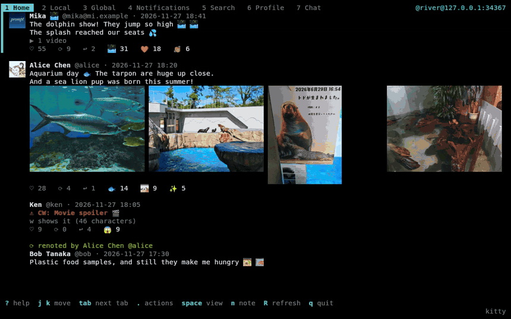

[](https://github.com/nao1215/misskey-terminal-client/actions/workflows/rust.yml)
[](https://github.com/nao1215/misskey-terminal-client/actions/workflows/e2e.yml)
[](https://github.com/nao1215/misskey-terminal-client/actions/workflows/trivy.yml)

[](https://github.com/nao1215/atago)
[](https://github.com/nao1215/himorime)
[](LICENSE)
[](https://scorecard.dev/viewer/?uri=github.com/nao1215/misskey-terminal-client)

# msky

A [Misskey](https://misskey-hub.net) client for the terminal. Pictures and videos are drawn in place.



It is written for Misskey itself; forks such as Sharkey may work, but they are not tested.

## Install

```sh
git clone https://github.com/nao1215/misskey-terminal-client
cd misskey-terminal-client
cargo install --locked --path .
```

It needs Rust 1.90 or later.

## Use

Run `msky`, pick a server, and allow msky in the browser that opens. MiAuth logs you in, so msky never sees your password, and `esc` reads the server as a visitor. `?` lists every key, `.` what the keys do to the selected note or account.

| Pictures with | Terminals |
|---|---|
| kitty graphics | kitty, Ghostty |
| sixel | foot, mlterm, Windows Terminal 1.22+ |
| iTerm2 images | iTerm2, WezTerm |

Other terminals get text, and `space` opens a note in the browser. Custom emoji are drawn as pictures. MP4 videos with H.264 play without sound; `d` saves other formats and `o` opens them. MFM is shown as plain text with bold kept, and `w` opens a content warning. Photos and videos are posted without their location data.

msky speaks English and 日本語: the language of your system, or the one chosen in the settings (`s`).

`+` on the Home tab: your antennas, lists, channels, notifications or a search in columns beside it


The demos show made-up notes served by [doc/demo-server.py](doc/demo-server.py), with the author's photos in [doc/demo](doc/demo).

## Keys

| Key | Action |
|---|---|
| `1`–`7` | Home, Local, Global, Notifications, Search, Profile, Chat |
| `+` `x` | Add a column, remove one |
| `j` `k` | Move |
| `n` `r` `Q` | Note, reply, quote |
| `l` `e` `b` | React ❤, choose a reaction, renote |
| `f` `M` `B` | Follow, mute, block |
| `D` `!` | Delete your note, report |
| `v` `space` `w` | Thread, pictures or video, content warning |
| `d` `o` `c` | Save files, open in the browser, copy the address |
| `/` | Search |
| `m` | Message the profile shown |
| `e` on your profile | Edit your profile |
| `A` `T` `s` | Accounts, themes, settings |
| `?` `q` | Help, quit |

The Chat tab is hidden on servers without chat, such as misskey.io.

## Commands

```sh
msky timeline -n 5
msky post "hello" --image cat.jpg
msky search Misskey --json | jq -r .url
```

`msky --help` lists them all. [doc/commands.md](doc/commands.md) covers logging in and its permissions, posting from CI, saving files, the JSON shape and the exit codes.

## Environment

| Variable | Meaning |
|---|---|
| `MSKY_HOST` | Server to read (also `--host`) |
| `MSKY_TOKEN` | Access token in place of the saved login, on `MSKY_HOST` only |
| `MSKY_CONFIG_DIR` | Config folder |
| `MSKY_CACHE_DIR` | Picture cache; `off` for none |
| `MSKY_DOWNLOAD_DIR` | Where `d` and `download` save |
| `MSKY_GRAPHICS` | `kitty`, `sixel` or `iterm2` |
| `MSKY_BROWSER` | Program that opens addresses |
| `LANG` | Language, unless one is chosen in the settings |
| `NO_COLOR` | No color |

## Other terminal clients

From their READMEs, November 2026.

| | msky | [misskey-cli](https://github.com/mikuta0407/misskey-cli) | [Misskey-TUI](https://github.com/yulog/misskey-tui) |
|---|---|---|---|
| Written in | Rust | Go | Go |
| Interface | Full screen, and commands | Commands | Full screen |
| Pictures and videos | Drawn in the terminal | Marked as attached | Not shown |
| Timelines | Home, local, global, social (commands) | Home, local, global, streaming | Home, local, social, global |
| Several columns | Yes | Not applicable | No |
| Several servers | Yes | Yes | No |
| Notifications | Yes | No | No |
| Chat | Yes | No | No |
| Posting | Text, pictures, video, reply, quote, content warning | Text, reply, renote, delete | Text, reply, renote |
| Follow, mute and block | Yes | No | No |
| Search | Notes and accounts | No | No |
| JSON output | Every command | No | Not applicable |
| Login | MiAuth in the browser | Access token in a TOML file | Access token in a JSON file |

## Related projects

- [bsky](https://github.com/nao1215/bluesky-terminal-client): the same client for Bluesky, with the same keys.

## Contributing

```sh
just test    # unit tests
just e2e     # end-to-end tests (atago)
```

See [CONTRIBUTING.md](CONTRIBUTING.md).

## License

[MIT](LICENSE). Not made by or affiliated with the Misskey project.
