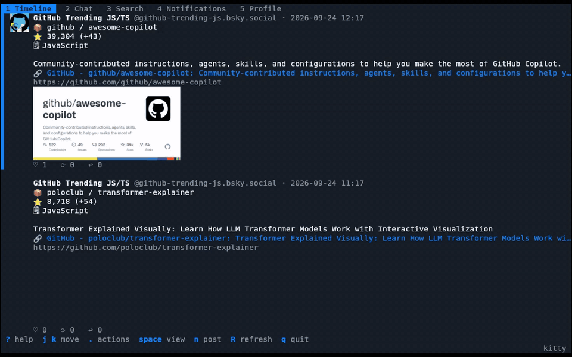
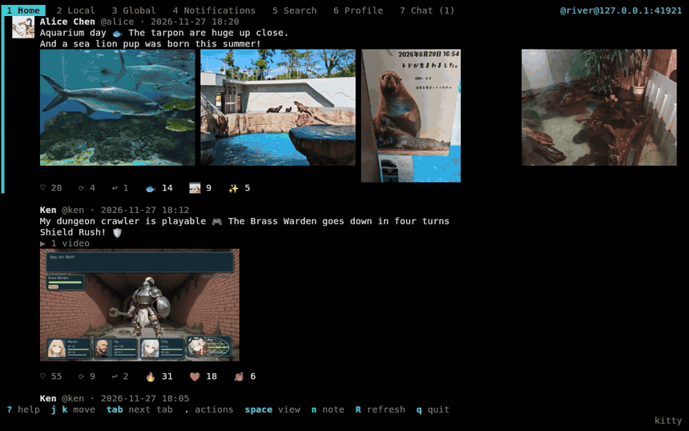
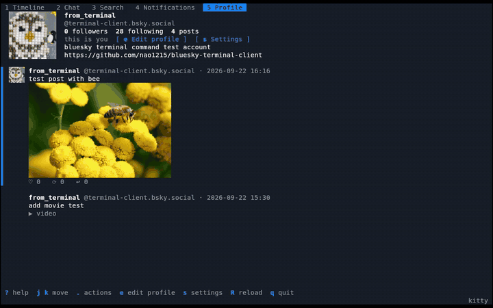
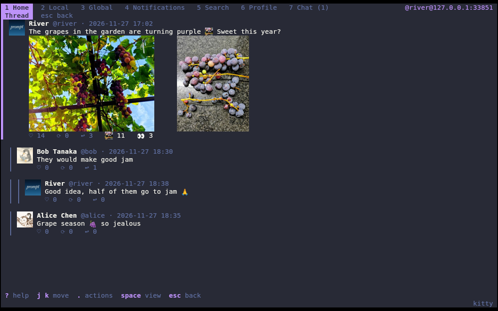
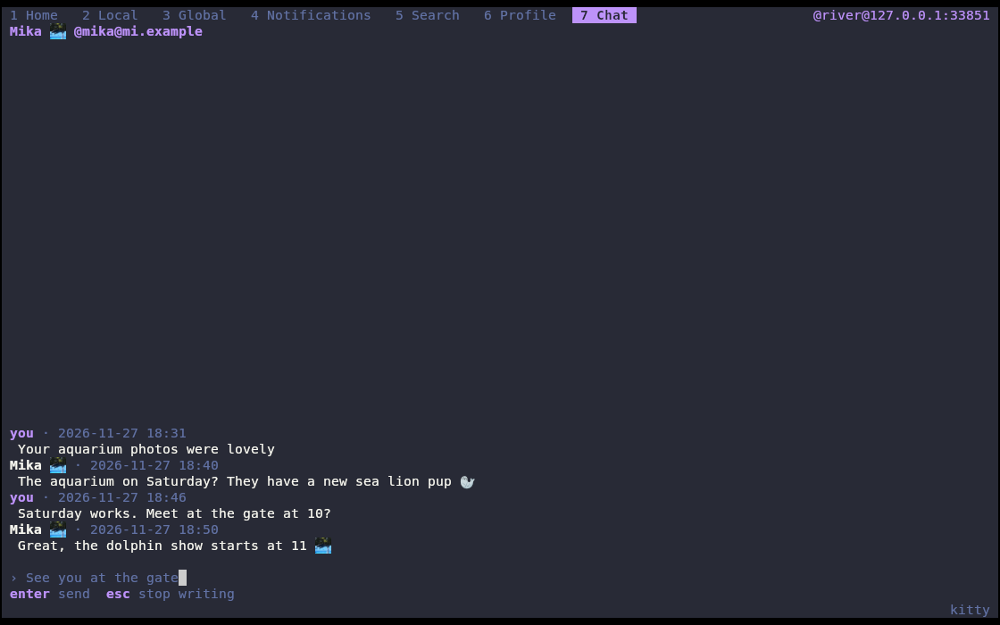
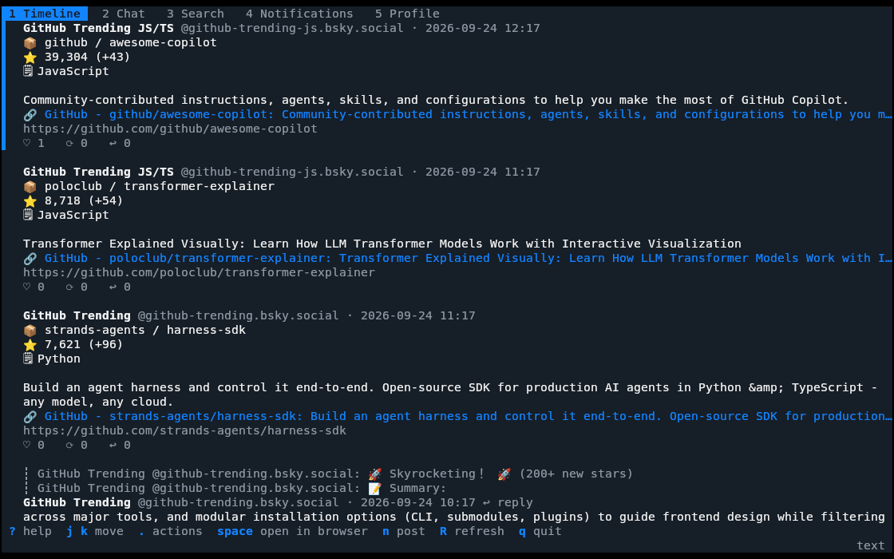
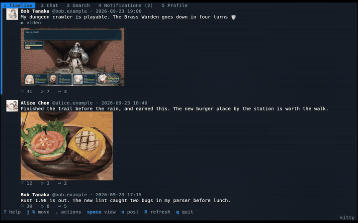
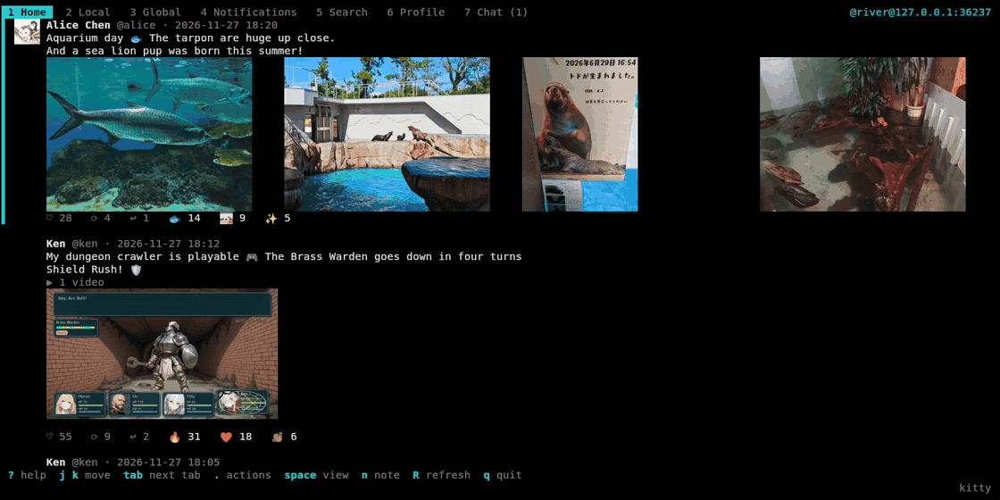
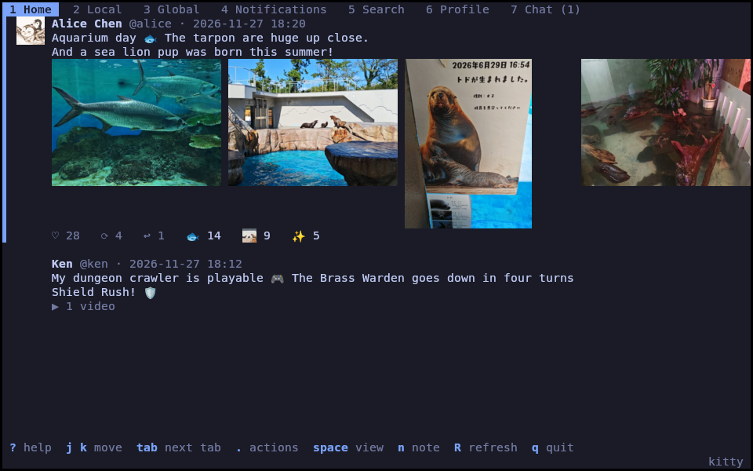
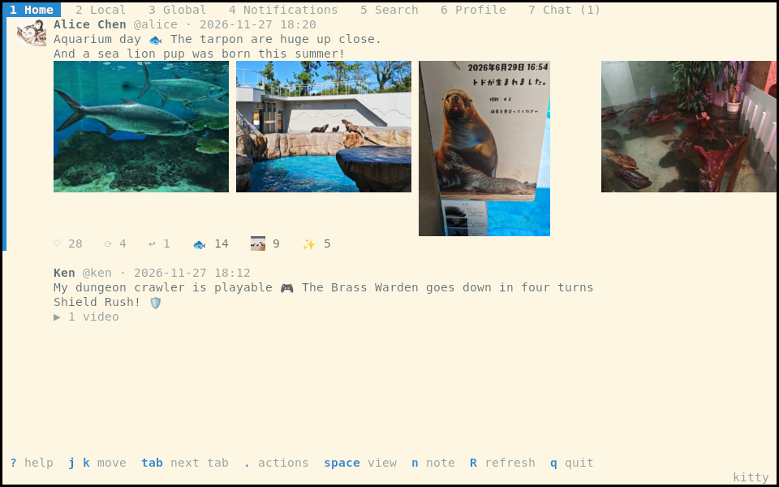

<!-- ALL-CONTRIBUTORS-BADGE:START - Do not remove or modify this section -->
[](#contributors)
<!-- ALL-CONTRIBUTORS-BADGE:END -->
[](https://github.com/nao1215/social-terminal-clients/actions/workflows/rust.yml)
[](https://github.com/nao1215/social-terminal-clients/actions/workflows/e2e.yml)

[](https://github.com/nao1215/social-terminal-clients/actions/workflows/gitleaks.yml)
[](https://github.com/nao1215/social-terminal-clients/actions/workflows/trivy.yml)
[](https://github.com/nao1215/social-terminal-clients/actions/workflows/cargo-deny.yml)
[](https://github.com/nao1215/atago)
[](https://github.com/nao1215/himorime)
[](./LICENSE)
[](https://scorecard.dev/viewer/?uri=github.com/nao1215/social-terminal-clients)


# social-terminal-clients

Unofficial [Bluesky](https://bsky.app), [Misskey](https://misskey-hub.net), [Mastodon](https://joinmastodon.org) and [Nostr](https://nostr.com) clients for the terminal: `bsky`, `msky`, `mstdn` and `nstr`. All four open a full-screen client and also have commands. bsky, msky and mstdn draw pictures and videos in place; nstr draws pictures.

<table>
  <tr>
    <th width="50%">bsky (Bluesky)</th>
    <th width="50%">msky (Misskey)</th>
  </tr>
  <tr>
    <td></td>
    <td></td>
  </tr>
</table>

| Client | Crate | Version | Downloads |
|---|---|---|---|
| bsky | `bluesky-terminal-client` | [](https://crates.io/crates/bluesky-terminal-client) |  |
| msky | `misskey-terminal-client` | [](https://crates.io/crates/misskey-terminal-client) |  |
| mstdn | `mastodon-terminal-client` | Unreleased | Not on crates.io |
| nstr | `nostr-terminal-client` | Unreleased | Not on crates.io |

## Install

bsky and msky with Homebrew:

```sh
brew install nao1215/tap/bsky nao1215/tap/msky
```

With Cargo:

```sh
cargo install --locked bluesky-terminal-client misskey-terminal-client
```

With cargo-binstall, which fetches a release binary:

```sh
cargo binstall bluesky-terminal-client misskey-terminal-client
```

mstdn and nstr have no release yet and install from this repository:

```sh
cargo install --locked --git https://github.com/nao1215/social-terminal-clients mastodon-terminal-client nostr-terminal-client
```

bsky's binaries for Linux, macOS and Windows are on the [releases page](https://github.com/nao1215/social-terminal-clients/releases), tagged `v<version>`. Each release carries the license texts of the crates its binaries contain in `<client>-<version>-THIRD_PARTY_LICENSES.html`. Building needs Rust 1.90 or later.

<details>
<summary>Verifying a release</summary>

A release carries `checksums.txt`, a cosign signature of it and SLSA provenance, and each archive has a GitHub build attestation (bsky from 0.13.0 on). Run each line in the directory with the downloaded files. `<tag>` is the release, for example `v0.15.0`, and `<archive>` is the file you downloaded.

```sh
sha256sum --ignore-missing --check checksums.txt
```

```sh
cosign verify-blob --bundle checksums.txt.sigstore.json --certificate-identity "https://github.com/nao1215/social-terminal-clients/.github/workflows/release.yml@refs/tags/<tag>" --certificate-oidc-issuer https://token.actions.githubusercontent.com checksums.txt
```

```sh
slsa-verifier verify-artifact <archive> --provenance-path bsky-<tag>.intoto.jsonl --source-uri github.com/nao1215/social-terminal-clients --source-tag <tag>
```

```sh
gh attestation verify <archive> --repo nao1215/social-terminal-clients
```

</details>

## Use

Run `bsky` or `msky` and log in: bsky with your handle and an [app password](https://bsky.app/settings/app-passwords), msky in the browser with MiAuth, so it never sees your password (`esc` reads a server as a visitor). mstdn logs in with `mstdn login`, by OAuth in the browser, and never sees the password either; `mstdn` without a login reads the local and federated timelines as a visitor. `?` lists every key, `.` what they do to the selected post.

nstr reads `config.json` in its config folder: your public key, one to sixteen relays you choose, and, for posting, a key file you place yourself (`chmod 600` on Unix). It has no default relay, checks the ID and signature of every event it reads, and opens the key file only for writes.

| Pictures with | Terminals |
|---|---|
| kitty graphics | kitty, Ghostty |
| sixel | foot, mlterm, Windows Terminal 1.22+ |
| iTerm2 images | iTerm2, WezTerm |

Other terminals get text. bsky, msky and mstdn have 42 themes, several accounts and notifications, and post photos and videos without their location data; all three also have columns and direct messages. All four clients print JSON in one shape from every command with `--json`.

On kitty, bsky plays the selected post's video in the timeline without sound; Play videos in the timeline in the settings or `BSKY_INLINE_VIDEO=0` turns it off.

Only bsky makes link cards and speaks nine languages (msky and mstdn speak English and 日本語). msky and mstdn draw custom emoji on terminals with graphics and keep their shortcodes on other terminals; msky also keeps MFM's bold. msky and mstdn fold content warnings until `w`. msky is tested against Misskey itself, not its forks.

## Screens

| bsky `space`: pictures and videos | msky `n` `ctrl+o`: attach pictures or a video |
|:--:|:--:|
|  |  |
| msky `v`: thread | bsky `/`: search |
|  |  |
| bsky `.`: actions | msky `e`: edit your profile |
|  |  |
| msky `7`: chat | bsky `A`: accounts |
|  |  |
| bsky `s`: settings | bsky without pictures |
|  |  |

bsky: only the selected post's video plays in the timeline, and its thumbnail comes back when the selection moves on



msky `+`: an antenna, then the notifications, beside the home timeline



`T`: 42 themes

| | | |
|:--:|:--:|:--:|
|  |  |  |
|  |  |  |

msky's screens and bsky's chat and accounts show made-up data served by each client's `doc/demo-server.py`; the composers browse the author's photos in `doc/demo`.

## Keys

| Key | bsky | msky | mstdn |
|---|---|---|---|
| `1` … | `1`–`5`: Timeline, Chat, Search, Notifications, Profile | `1`–`7`: Home, Local, Global, Notifications, Search, Profile, Chat | `1`–`7`: Home, Local, Federated, Notifications, Search, Profile, Chat |
| `+` `x` | Add a column, remove one | Add a column, remove one | Add a column, remove one |
| `j` `k` | Move | Move | Move |
| `n` `r` `Q` | Post, reply, quote | Note, reply, quote | Post, reply, quote (Mastodon 4.5+) |
| `l` | Like | React ❤ | Favourite |
| `e` | Edit your profile (on it) | Choose a reaction; edit your profile (on it) | Edit your profile (on it) |
| `b` `f` | Repost, follow | Renote, follow | Boost, follow |
| `M` `B` `D` | Mute, block, delete your post | Mute, block, delete your note | Mute, block, delete your post |
| `!` | | Report | Report |
| `v` `space` | Thread, pictures or video | Thread, pictures or video | Thread, pictures or video |
| `w` | | Content warning | Content warning |
| `d` `o` `c` | `d` in the viewer: save; `o`: link | Save files, open in the browser, copy the address | Save files, open in the browser, copy the address |
| `/` `m` | Search, message the profile shown | Search, message the profile shown | Search, message the profile shown |
| `A` `T` `s` | Accounts, themes, settings | Accounts, themes, settings | Accounts, themes, settings |
| `?` `q` | Help, quit | Help, quit | Help, quit |

nstr opens Home, Notifications and Profile with `1`, `2` and `3`. `j` and `k` move through notes, with more loading near the end; `v` opens the thread, `n` composes a new note and `r` replies, with Ctrl+S to send. `l` sends a `+` reaction, `b` reposts, `c` copies a `nostr:nevent1...` identifier, and Space opens pictures. `s` opens theme and language settings, `T` previews themes, `?` shows help and `q` quits. Theme and language are kept in `settings.json` beside `config.json`; the status row shows relay response counts and warnings. Writes use the configured key file or NIP-46 bunker.

## Commands

The four clients share command names and options. `-n` sets how many to print (20 by default), `--json` prints one JSON object per line with the same keys on every client, and `--help` lists the rest. msky and mstdn take `--host` for the server. Below, msky reads made-up notes from its `doc/demo-server.py`.

```console
$ msky timeline -n 2
Alice Chen @alice · 2026-11-27 18:20
Aquarium day 🐟 The tarpon are huge up close.
And a sea lion pup was born this summer!
[4 pictures]
🐟 14  :todo: 9  ✨ 5
♡ 28  ⟳ 4  ↩ 1
http://127.0.0.1:40929/notes/n2

Ken @ken · 2026-11-27 18:12
My dungeon crawler is playable 🎮 The Brass Warden goes down in four turns
Shield Rush! 🛡️
[1 video]
🔥 31  ❤️ 18  👏🏽 6
♡ 55  ⟳ 9  ↩ 2
http://127.0.0.1:40929/notes/n1
```

`--json` with the keys every client prints, so the same `jq` works with `bsky`, `mstdn` and `nstr`:

```console
$ msky timeline -n 2 --json | jq -r '[.user.username, .likeCount, .url] | @tsv'
alice	28	http://127.0.0.1:40929/notes/n2
ken	55	http://127.0.0.1:40929/notes/n1
```

`--dry-run` checks a post and the login and sends nothing:

```console
$ msky post --dry-run 'Hello from the terminal'
dry run: nothing was sent to 127.0.0.1:40929
as @river@127.0.0.1:40929, public
text:
Hello from the terminal
no preview: the text has no link Misskey previews
```

| Command | bsky | msky | mstdn | nstr |
|---|---|---|---|---|
| `timeline`, `notifications`, `search`, `post`, `whoami` | Yes | Yes | Yes | Yes |
| `author`, `thread`, `profile`, `download` | Yes | Yes | Yes | |
| `like`, `repost`, `follow`, `mute`, `block`, `delete`, `report`, `chat` and their undo | Yes | Yes | | |
| `login`, `logout`, `accounts` | Yes | Yes | Yes | |

`bsky author` reads an account's own feed page by page, so it leaves out nothing a search for `from:` can miss. `download` saves a post's pictures and video where `d` in the viewer does, and `author ... --download` saves those of every post it read. msky and mstdn take an access token in `MSKY_TOKEN` and `MSTDN_TOKEN` for posting from CI. Without a login, `mstdn search` reads only a hashtag's posts, since Mastodon's full-text search finds nothing for a visitor. `nstr post` signs a public text note and sends it once to each configured relay, and succeeds when one of them accepts it.

## Environment

| Meaning | bsky | msky | mstdn | nstr |
|---|---|---|---|---|
| Account or server for this run | `BSKY_ACCOUNT` (also `-a`) | `MSKY_HOST` (also `--host`) | `MSTDN_HOST` (also `--host`) | |
| Access token in place of the saved login | | `MSKY_TOKEN`, on `MSKY_HOST` only | `MSTDN_TOKEN`, on `MSTDN_HOST` only | |
| Config folder | `BSKY_CONFIG_DIR` | `MSKY_CONFIG_DIR` | `MSTDN_CONFIG_DIR` | `NSTR_CONFIG_DIR` |
| Picture cache; `off` for none | `BSKY_CACHE_DIR` | `MSKY_CACHE_DIR` | `MSTDN_CACHE_DIR` | |
| Where files are saved | `BSKY_DOWNLOAD_DIR` | `MSKY_DOWNLOAD_DIR` | `MSTDN_DOWNLOAD_DIR` | |
| `kitty`, `sixel` or `iterm2` | `BSKY_GRAPHICS` | `MSKY_GRAPHICS` | `MSTDN_GRAPHICS` | |
| Program that opens links | `BSKY_BROWSER` | `MSKY_BROWSER` | `MSTDN_BROWSER` | |
| PDS to log in to (also `--service`) | `BSKY_SERVICE` | | | |
| Video upload service | `BSKY_VIDEO_SERVICE` | | | |
| Timeline video playback; `0` off, `1` on | `BSKY_INLINE_VIDEO` | | | |
| `off` for posts without a link card | `BSKY_LINK_CARDS` | | | |

`LANG` picks the language unless one is chosen in the settings (mstdn and nstr read `LC_ALL` and `LC_MESSAGES` before it), and `NO_COLOR` turns color off.

## Other terminal clients

From their READMEs and source, September 2026.

| | bsky | [tuisky](https://github.com/sugyan/tuisky) | [mattn/bsky](https://github.com/mattn/bsky) |
|---|---|---|---|
| Written in | Rust | Rust | Go |
| Interface | Full screen, and commands | Full screen | Commands |
| Pictures and videos | Drawn in the terminal | Links to the browser | Not shown |
| Several columns | Yes | Yes | Not applicable |
| Several accounts | Yes | Yes | Yes |
| Refreshes by itself | Chat only | Yes | `stream` |
| Notifications | Yes | No | Yes |
| Direct messages | Yes | No | Yes |
| Posting | Text, pictures, video, reply, quote | Text, pictures, quote | Text, pictures, video, reply, quote |
| Mute and block | Yes | No | Yes |
| Lists, report, app passwords | Yes | No | Yes |
| Invite codes | No | No | Yes |
| JSON output | Every command | No | Most commands |
| Key bindings | Fixed | Set in TOML | Not applicable |
| MCP server | No | No | Yes |

From their READMEs, November 2026.

| | msky | [misskey-cli](https://github.com/mikuta0407/misskey-cli) | [Misskey-TUI](https://github.com/yulog/misskey-tui) |
|---|---|---|---|
| Written in | Rust | Go | Go |
| Interface | Full screen, and commands | Commands | Full screen |
| Pictures and videos | Drawn in the terminal | Marked as attached | Not shown |
| Timelines | Home, local, global, social (commands) | Home, local, global, streaming | Home, local, social, global |
| Several columns | Yes | Not applicable | No |
| Several servers | Yes | Yes | No |
| Notifications | Yes | No | No |
| Chat | Yes | No | No |
| Posting | Text, pictures, video, reply, quote, content warning | Text, reply, renote, delete | Text, reply, renote |
| Follow, mute and block | Yes | No | No |
| Search | Notes and accounts | No | No |
| JSON output | Every command | No | Not applicable |
| Login | MiAuth in the browser | Access token in a TOML file | Access token in a JSON file |

## Testing

| Technique | Bug class caught here | Clients |
|---|---|---|
| Unit tests | Wrong answers for the cases someone wrote down | All four |
| Property-based tests | Split emoji, lines wider than the column, and text nobody listed | All four |
| End-to-end tests ([atago](https://github.com/nao1215/atago)) | Wrong screens, pictures, requests and files from the real binary on Linux, macOS and Windows | All four |
| Fuzzing | Panics and wrong answers on malformed videos, posts, web pages and protocol messages | All four |
| Mutation tests | Lines the tests run but whose answer no test checks | All four |
| Benchmarks ([himorime](https://github.com/nao1215/himorime)) | Slower start-up and commands slipping in unnoticed | All four |

The end-to-end tests need no network or account: msky's and mstdn's talk to atago mocks of their APIs, and nstr's to a relay stand-in on 127.0.0.1 with throwaway keys.

## Contributing

Each client is a crate in `crates/`, and `crates/terminal-kit` holds the terminal code they share.

```sh
just test         # unit tests of every crate
just e2e          # end-to-end tests of every client (atago)
just e2e-mstdn    # one client's (also e2e-bsky, e2e-msky, e2e-nstr; nstr's needs python3)
```

See [CONTRIBUTING.md](CONTRIBUTING.md).

## Contributors

Everyone who reports a bug, suggests a feature, sends a pull request, or packages a client is listed here ([emoji key](https://allcontributors.org/docs/en/emoji-key)).

<!-- ALL-CONTRIBUTORS-LIST:START - Do not remove or modify this section -->
<!-- prettier-ignore-start -->
<!-- markdownlint-disable -->
<table>
  <tbody>
    <tr>
      <td align="center" valign="top" width="14.28%"><a href="https://debimate.jp/"><br /><sub><b>CHIKAMATSU Naohiro</b></sub></a><br /><a href="https://github.com/nao1215/social-terminal-clients/commits?author=nao1215" title="Code">💻</a> <a href="https://github.com/nao1215/social-terminal-clients/commits?author=nao1215" title="Documentation">📖</a></td>
    </tr>
  </tbody>
</table>

<!-- markdownlint-restore -->
<!-- prettier-ignore-end -->

<!-- ALL-CONTRIBUTORS-LIST:END -->

## License

[MIT](LICENSE). Not made by or affiliated with Bluesky Social PBC, the Misskey project or the Mastodon project.
